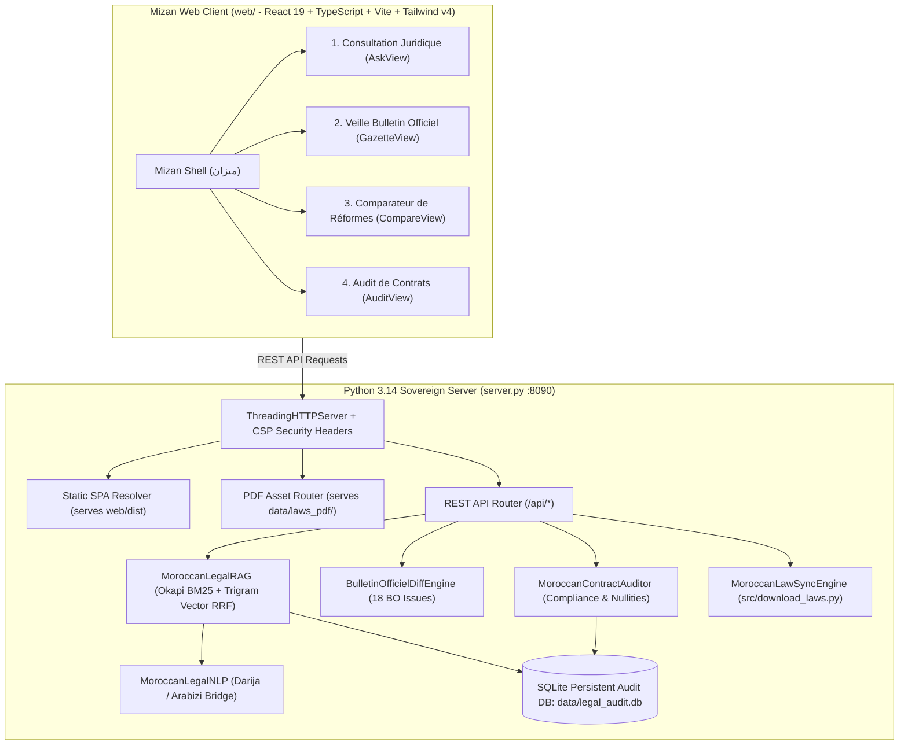

# 1. System Architecture & Tech Stack

## 1.1 Architectural Overview

Mizan is engineered as a unified, high-performance sovereign legal tech platform:

## 1.2 Grounded Statutory RAG with Reciprocal Rank Fusion

The statutory retrieval engine (`src/legal_rag.py`) avoids brittle semantic-only vector lookups by executing a two-stage hybrid fusion:

1. **Okapi BM25 Lexical Ranking:**
   Matches formal Arabic and French statutory tokens using Okapi BM25 with calibrated parameters:
   $$\text{score}(D, Q) = \sum_{i=1}^{n} \text{IDF}(q_i) \cdot \frac{f(q_i, D) \cdot (k_1 + 1)}{f(q_i, D) + k_1 \cdot \left(1 - b + b \cdot \frac{|D|}{\text{avgdl}}\right)}$$
   where $k_1 = 1.5$ and $b = 0.75$.

2. **Character Trigram Vector Cosine Similarity:**
   Generates character 3-gram frequency vectors for both Arabic and French text, capturing root morphemes, prefix variations (e.g., `و`, `ف`, `ب`, `ل`), and French declensions. Cosine similarity evaluates phonetic/morphological proximity.

3. **Reciprocal Rank Fusion (RRF):**
   Fuses the rankings from BM25 and Trigram Vector retrieval with smoothing parameter $k = 60$:
   $$\text{RRF\_Score}(d) = \frac{1}{60 + \text{rank}_{\text{BM25}}(d)} + \frac{1}{60 + \text{rank}_{\text{Trigram}}(d)}$$

4. **Anti-Hallucination Verification Gate (`verify_citations`):**
   Every generated response must strictly cite articles present in the top-ranked retrieved statutory corpus. If an unverified article ID is detected, the verification gate intercepts and suppresses the hallucination.

## 1.3 Front-End Architecture (`web/`)

- **Framework:** React 19 + TypeScript.
- **Build Tool:** Vite 8 (builds in ~500ms).
- **Styling:** Tailwind CSS v4 with custom CSS variables for light/dark sovereign chamber themes.
- **Typography:** Authentic `Bouazzi Maghribi` font (`unicode-range: U+0600-06FF`), `IBM Plex Sans Arabic`, and `Geist`.
- **RTL Mirroring:** Full HTML `<html lang="ar" dir="rtl">` switching dynamically mirrors grid columns, flex flows, sidebars, and tab layouts.
